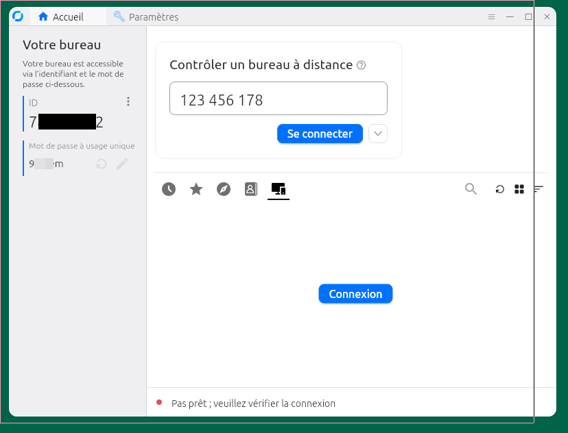
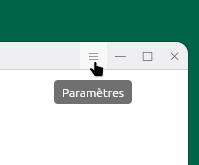
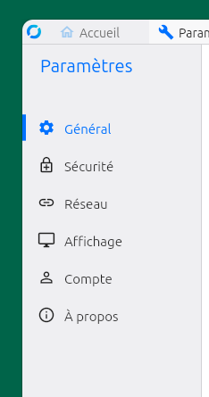
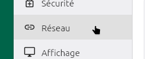
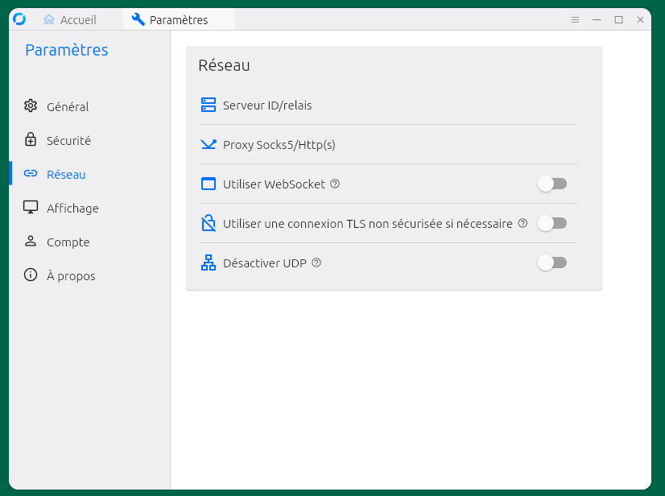
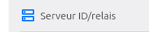
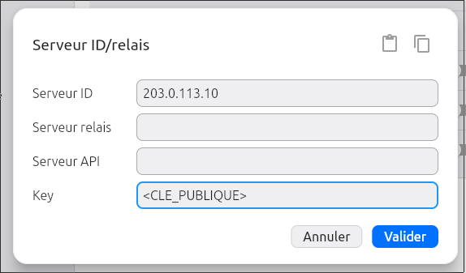
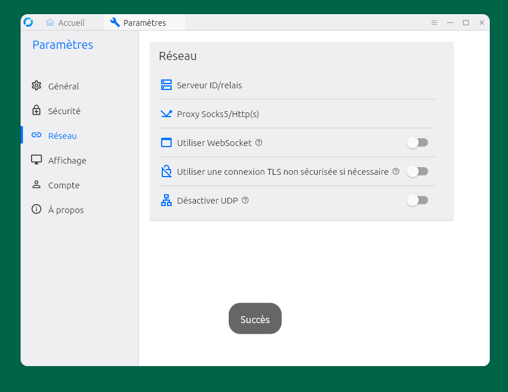

Ce tutoriel explique comment héberger son propre serveur RustDesk dans un conteneur LXD, à l'aide du script d'installation [techahold/rustdeskinstall](https://github.com/techahold/rustdeskinstall). C'est la méthode 2 de la [documentation officielle](https://rustdesk.com/docs/en/self-host/rustdesk-server-oss/install/).

Un serveur RustDesk se compose de deux programmes :

- **hbbs**, le **serveur ID** (ou serveur de rendez-vous) : il enregistre les postes et les met en relation ;
- **hbbr**, le **relais** : il fait transiter le trafic quand les deux postes ne peuvent pas se connecter directement.

> Les adresses, noms et clés de ce tutoriel sont des **exemples**. Les remplacer par ses propres valeurs.

## Valeurs utilisées dans ce tutoriel

| Élément                   | Valeur d'exemple                                |
|---------------------------|-------------------------------------------------|
| Hôte                      | `serveur.example.com` (Ubuntu 24.04)            |
| IP publique de l'hôte     | `203.0.113.10`                                  |
| Interface réseau publique | `eno1`                                          |
| Bridge LXD                | `lxdbr0` – `10.10.10.1/24`                      |
| Conteneur                 | `rustdesk` (Debian 12)                          |
| IP fixe du conteneur      | `10.10.10.50`                                   |
| Dossier d'installation    | `/opt/rustdesk`                                 |
| Services                  | `rustdesksignal` (hbbs), `rustdeskrelay` (hbbr) |
| Clé publique              | `<CLE_PUBLIQUE>` (générée à l'installation)     |
| Poste client              | `utilisateur@poste`                             |
| Nom de domaine (option)   | `rustdesk.example.com`                          |

## Prérequis

- Un serveur Ubuntu avec un accès SSH et les droits sudo.
- Une IP publique fixe, ou un nom de domaine qui pointe dessus.
- LXD installé et initialisé (voir ci-dessous).

### Installer LXD (si ce n'est pas déjà fait)

Sur Ubuntu, LXD est distribué sous forme de paquet snap :

```bash
utilisateur@serveur:~$ sudo snap install lxd
```

Ajouter l'utilisateur au groupe `lxd`, pour pouvoir lancer les commandes `lxc` sans sudo :

```bash
utilisateur@serveur:~$ sudo usermod -aG lxd $USER
```

> Se déconnecter puis se reconnecter en SSH pour que l'appartenance au groupe soit prise en compte.

Initialiser LXD. Les réponses par défaut conviennent : elles créent notamment le bridge `lxdbr0` et un espace de stockage.

```bash
utilisateur@serveur:~$ lxd init
```

Vérifier que tout fonctionne :

```bash
utilisateur@serveur:~$ lxc list
+------+-------+------+------+------+-----------+
| NAME | STATE | IPV4 | IPV6 | TYPE | SNAPSHOTS |
+------+-------+------+------+------+-----------+
```

## Pourquoi LXD ?

LXD est un gestionnaire de **conteneurs système** développé par Canonical. Un conteneur LXD se comporte comme une petite machine Linux complète (systemd, apt, services), mais il partage le noyau de l'hôte. C'est la différence avec Docker, dont les conteneurs n'embarquent en général qu'une seule application.

**Avantages**

- **Isolation** : RustDesk tourne à part, sans toucher au système de l'hôte ni aux autres services.
- **Légèreté** : pas de noyau séparé comme dans une machine virtuelle. Le conteneur démarre en quelques secondes et consomme peu de mémoire.
- **Simplicité** : on l'administre comme un serveur Debian classique. Le script d'installation fonctionne donc tel quel.
- **Sauvegarde et retour arrière** : snapshots et export du conteneur en une commande (voir [Sauvegarde](#12-sauvegarde)).
- **Nettoyage facile** : supprimer le conteneur retire RustDesk sans laisser de traces sur l'hôte.

**Inconvénients**

- **Isolation moins forte qu'une VM** : le noyau est partagé avec l'hôte. Une faille du noyau peut toucher tous les conteneurs.
- **Réseau plus complexe** : le conteneur est sur un réseau privé. Il faut une IP fixe et des proxy devices pour l'exposer.
- **Une couche de plus à maintenir** : il faut mettre à jour l'hôte **et** le conteneur.
- **Moins documenté** : la documentation de RustDesk traite surtout de Docker et de l'installation directe sur l'hôte.

> Incus, le fork communautaire de LXD, s'utilise de la même façon : les commandes `lxc` deviennent `incus`.

## Principe

Le conteneur se trouve sur un réseau privé (`lxdbr0`). Les ports RustDesk sont redirigés depuis l'IP publique de l'hôte vers le conteneur grâce à des **proxy devices LXD en mode `nat=true`**.

Ce mode est essentiel : il préserve l'**IP réelle des clients**. Le serveur ID (hbbs) en a besoin pour établir des connexions directes entre les postes (*hole punching*). Sans lui, tout le trafic passe par le relais.

Chemin d'une connexion :

```
Client RustDesk
      │
      ▼
IP publique de l'hôte : 203.0.113.10
ports 21115-21117 (TCP) et 21116 (UDP)
      │
      ▼
Règle DNAT nftables, créée par LXD (nat=true)
      │   adresse de destination réécrite, IP du client conservée
      ▼
Conteneur rustdesk : 10.10.10.50
hbbs (21115, 21116) – hbbr (21117)
```

> En mode `nat=true`, aucun programme proxy ne relaie le trafic : le noyau de l'hôte redirige directement les paquets. Sans `nat=true`, un processus `forkproxy` de LXD recevrait les connexions et les rouvrirait vers le conteneur, qui verrait alors l'IP de l'hôte au lieu de celle du client.

Quelques termes utilisés dans la suite :

- **Proxy device** : redirection de port déclarée dans la configuration LXD du conteneur. Avec `nat=true`, elle se traduit par une simple règle DNAT sur l'hôte, sans aucun programme qui tourne. C'est l'équivalent de la page « Redirection de ports » d'une box : on déclare la redirection, LXD crée la règle. Par rapport à des règles nftables écrites à la main, LXD les crée et les supprime avec le conteneur, les conserve après un redémarrage de l'hôte, les inclut dans les exports et snapshots, et évite les conflits avec ses propres règles.
- **NAT / DNAT** : le NAT réécrit les adresses des paquets. Le plus courant est le **SNAT**, qui change l'adresse **source** : c'est ce que fait une box internet quand un PC du réseau local sort sur Internet. Le **DNAT** change l'adresse **de destination** : c'est la « redirection de port » des box. Ici, un paquet destiné à `203.0.113.10:21116` est redirigé vers `10.10.10.50:21116`, sans toucher à sa source. Avec `nat=true`, LXD crée cette règle dans le noyau de l'hôte, au lieu de faire transiter le trafic par un programme intermédiaire. L'IP d'origine du client est ainsi conservée.
- **Hole punching** : technique qui permet à deux postes situés derrière des box ou des pare-feu de se connecter directement l'un à l'autre, avec l'aide du serveur ID.
- **INPUT / FORWARD** : chaînes du pare-feu Linux. *INPUT* filtre le trafic destiné à l'hôte lui-même, *FORWARD* celui qui le traverse pour aller ailleurs (ici, vers le conteneur).

---

## 1. Connexion au serveur

```bash
utilisateur@poste:~$ ssh utilisateur@serveur.example.com
utilisateur@serveur.example.com's password:
Welcome to Ubuntu 24.04.4 LTS (GNU/Linux 6.8.0-87-generic x86_64)
utilisateur@serveur:~$
```

## 2. Création du conteneur

```bash
utilisateur@serveur:~$ lxc launch images:debian/12 rustdesk
Creating rustdesk
Starting rustdesk
```

```bash
utilisateur@serveur:~$ lxc list
+----------+---------+----------------------+-----------------------------------------------+-----------+-----------+
|   NAME   |  STATE  |         IPV4         |                     IPV6                      |   TYPE    | SNAPSHOTS |
+----------+---------+----------------------+-----------------------------------------------+-----------+-----------+
| rustdesk | RUNNING | 10.10.10.120 (eth0)  | fd42:e702:d7b9:a433:216:3eff:fe1a:5683 (eth0) | CONTAINER | 0         |
+----------+---------+----------------------+-----------------------------------------------+-----------+-----------+
```

Le conteneur reçoit d'abord une IP dynamique attribuée par le DHCP de LXD : `10.10.10.120`.

## 3. Attribution d'une IP fixe

> L'IP fixe est obligatoire pour les proxy devices en mode `nat=true`.

- Repérer le sous-réseau du bridge :

```bash
utilisateur@serveur:~$ lxc network get lxdbr0 ipv4.address
10.10.10.1/24
```

- Lister les IP déjà utilisées, pour éviter un conflit :

```bash
utilisateur@serveur:~$ lxc list -c n4
```

- Fixer l'IP du conteneur dans ce sous-réseau :

```bash
utilisateur@serveur:~$ lxc config device override rustdesk eth0 ipv4.address=10.10.10.50
Device eth0 overridden for rustdesk
```

- Redémarrer le conteneur :

```bash
utilisateur@serveur:~$ lxc restart rustdesk
```

- Vérifier :

```bash
utilisateur@serveur:~$ lxc list rustdesk
+----------+---------+----------------------+-----------------------------------------------+-----------+-----------+
|   NAME   |  STATE  |         IPV4         |                     IPV6                      |   TYPE    | SNAPSHOTS |
+----------+---------+----------------------+-----------------------------------------------+-----------+-----------+
| rustdesk | RUNNING | 10.10.10.50 (eth0)   | fd42:e702:d7b9:a433:216:3eff:fe1a:5683 (eth0) | CONTAINER | 0         |
+----------+---------+----------------------+-----------------------------------------------+-----------+-----------+
```

## 4. Identification de l'IP publique

```bash
utilisateur@serveur:~$ ip -4 addr show scope global
2: eno1: <BROADCAST,MULTICAST,UP,LOWER_UP> mtu 1500 qdisc mq state UP group default qlen 1000
    altname enp4s0f0
    inet 203.0.113.10/24 metric 100 brd 203.0.113.255 scope global dynamic eno1
       valid_lft 78107sec preferred_lft 78107sec
18: lxdbr0: <BROADCAST,MULTICAST,UP,LOWER_UP> mtu 1500 qdisc noqueue state UP group default qlen 1000
    inet 10.10.10.1/24 scope global lxdbr0
       valid_lft forever preferred_lft forever
32: lxcbr0: <NO-CARRIER,BROADCAST,MULTICAST,UP> mtu 1500 qdisc noqueue state DOWN group default qlen 1000
    inet 10.0.3.1/24 brd 10.0.3.255 scope global lxcbr0
       valid_lft forever preferred_lft forever
```

L'IP publique est `203.0.113.10`, sur l'interface externe `eno1`. Ne pas la confondre avec `lxdbr0` (bridge LXD) ni avec `lxcbr0` (ancien bridge LXC, souvent inactif).

> Ici, la mention `dynamic` indique que l'IP est attribuée par DHCP. Les règles DNAT créées par les proxy devices ne redirigent que les paquets destinés à cette adresse précise : si elle change, la redirection cesse de fonctionner et il faut mettre à jour l'adresse `listen` des proxy devices. Vérifier que l'hébergeur garantit une IP stable.

## 5. Redirection des ports (proxy devices LXD)

| Port  | Protocole | Rôle              |
|-------|-----------|-------------------|
| 21115 | TCP       | Test NAT (hbbs)   |
| 21116 | TCP + UDP | Serveur ID (hbbs) |
| 21117 | TCP       | Relais (hbbr)     |

Ports à **ne pas** rediriger :

- **21114** : API, réservée à la version Pro.

Sur l'hôte :

```bash
utilisateur@serveur:~$ lxc config device add rustdesk rd-tcp proxy \
  listen=tcp:203.0.113.10:21115-21117 connect=tcp:10.10.10.50:21115-21117 nat=true
Device rd-tcp added to rustdesk
```

```bash
utilisateur@serveur:~$ lxc config device add rustdesk rd-udp proxy \
  listen=udp:203.0.113.10:21116 connect=udp:10.10.10.50:21116 nat=true
Device rd-udp added to rustdesk
```

- Vérifier :

```bash
utilisateur@serveur:~$ lxc config device show rustdesk
eth0:
  ipv4.address: 10.10.10.50
  name: eth0
  network: lxdbr0
  type: nic
rd-tcp:
  connect: tcp:10.10.10.50:21115-21117
  listen: tcp:203.0.113.10:21115-21117
  nat: "true"
  type: proxy
rd-udp:
  connect: udp:10.10.10.50:21116
  listen: udp:203.0.113.10:21116
  nat: "true"
  type: proxy
```

- Contrôler les règles DNAT créées automatiquement par LXD :

```bash
utilisateur@serveur:~$ sudo nft list ruleset | grep 2111
    ip daddr 203.0.113.10 tcp dport 21115-21117 dnat ip to 10.10.10.50
    ip saddr 10.10.10.50 ip daddr 10.10.10.50 tcp dport 21115-21117 masquerade
    ip daddr 203.0.113.10 udp dport 21116 dnat ip to 10.10.10.50:21116
    ip saddr 10.10.10.50 ip daddr 10.10.10.50 udp dport 21116 masquerade
```

- Si le pare-feu ufw est actif sur l'hôte, autoriser le trafic **redirigé** vers le conteneur :

```bash
utilisateur@serveur:~$ sudo ufw route allow proto tcp to 10.10.10.50 port 21115:21117
utilisateur@serveur:~$ sudo ufw route allow proto udp to 10.10.10.50 port 21116
```

> Avec `nat=true`, les paquets sont redirigés (DNAT) vers le conteneur : ils traversent la chaîne *FORWARD* et non *INPUT*. Un simple `ufw allow 21116` ne suffit donc pas, il faut des règles `ufw route`.

## 6. Installation de RustDesk dans le conteneur

### Avant de commencer : utiliser un nom de domaine (facultatif, conseillé)

Le script demande si les clients joindront le serveur par son IP ou par un nom de domaine. Ce choix est à faire **avant** de lancer l'installation.

Avec un nom de domaine, les clients ne dépendent plus de l'IP du serveur. Si l'IP change, ou si le serveur est déplacé sur un autre hôte, il suffit de modifier l'enregistrement DNS : aucun client n'est à reconfigurer.

- Chez le fournisseur DNS, créer un enregistrement **A** qui pointe vers l'IP publique de l'hôte :

| Nom                    | Type | Valeur         |
|------------------------|------|----------------|
| `rustdesk.example.com` | A    | `203.0.113.10` |

- Vérifier depuis le poste que le nom est bien résolu :

```bash
utilisateur@poste:~$ dig +short rustdesk.example.com
203.0.113.10
```

- Au lancement de `install.sh` (plus bas), répondre `2` (DNS/Domain) à la première question, puis saisir `rustdesk.example.com`.
- Dans les clients (étape 10), indiquer `rustdesk.example.com` comme **Serveur ID** au lieu de l'IP.

> Les règles DNAT des proxy devices (étape 5) visent toujours l'IP publique de l'hôte : le nom de domaine ne change rien côté serveur. En cas de changement d'IP, il faut donc mettre à jour **à la fois** l'enregistrement DNS et l'adresse `listen` des proxy devices.

Si le serveur a déjà été installé avec une IP, il n'est pas nécessaire de relancer le script : il suffit de créer l'enregistrement DNS et de remplacer l'IP par le nom dans les clients. La clé reste la même.

### Installation

- Entrer dans le conteneur :

```bash
utilisateur@serveur:~$ lxc exec rustdesk -- bash
root@rustdesk:~#
```

> Une fois dans le conteneur (`root@rustdesk`), les commandes `lxc` ne sont plus disponibles.

- Installer les paquets de base :

```bash
root@rustdesk:~# apt update && apt install -y wget sudo curl
...
Setting up curl (7.88.1-10+deb12u15) ...
Processing triggers for libc-bin (2.36-9+deb12u14) ...
```

- Télécharger le script :

```bash
root@rustdesk:~# wget https://raw.githubusercontent.com/techahold/rustdeskinstall/master/install.sh
...
HTTP request sent, awaiting response... 200 OK
Saving to: 'install.sh'
'install.sh' saved [14210/14210]
```

- Rendre le script exécutable :

```bash
root@rustdesk:~# chmod +x install.sh
```

- Lancer l'installation :

```bash
root@rustdesk:~# ./install.sh
sudo detected and will be used.
Installing prerequisites
...
1) IP
2) DNS/Domain
Choose your preferred connection method: auto-resolve current WAN IP or enter your DNS/Domain:1
Creating /opt/rustdesk
Installing Rustdesk Server
...
Tidying up install
Grabbing installers
<CHAINE_DE_CONFIGURATION>
1) Yes
2) No
Please choose if you want to download configs and install HTTP server:2
Your IP/DNS Address is 203.0.113.10
Your public key is <CLE_PUBLIQUE>
Install Rustdesk on your machines and change your public key and IP/DNS name to the above
...
Press any key to finish install
```

Réponses aux questions du script :

| Question du script                                         | Signification                                         | Réponse conseillée                                                |
|------------------------------------------------------------|-------------------------------------------------------|-------------------------------------------------------------------|
| *Choose your preferred connection method*                  | Méthode de connexion (IP ou DNS)                      | `1` : IP (détection automatique), ou `2` avec un nom de domaine   |
| *Please choose if you want to download configs and install HTTP server* | Télécharger les configs et installer un serveur HTTP | `2` : Non (évite d'exposer un service web supplémentaire)         |

> **Noter la clé publique** affichée à la fin (`Your public key is …`). Elle sera demandée par chaque client à l'étape 10.

Elle reste disponible dans le conteneur :

```bash
root@rustdesk:~# cat /opt/rustdesk/id_ed25519.pub
<CLE_PUBLIQUE>
```

La `<CHAINE_DE_CONFIGURATION>` encode l'IP et la clé. Elle peut être importée dans les clients, mais son champ `api` doit ensuite être vidé (voir [Dépannage](#11-dépannage)).

## 7. Vérification des services

Dans le conteneur :

```bash
root@rustdesk:~# systemctl list-units | grep -i rust
  rustdeskrelay.service    loaded active running   Rustdesk Relay Server
  rustdesksignal.service   loaded active running   Rustdesk Signal Server
```

```bash
root@rustdesk:~# ss -tulpn | grep 2111
udp   UNCONN 0   0     *:21116   *:*   users:(("hbbs",pid=1203,fd=7))
tcp   LISTEN 0   128   *:21115   *:*   users:(("hbbs",pid=1203,fd=13))
tcp   LISTEN 0   128   *:21119   *:*   users:(("hbbr",pid=1432,fd=10))
tcp   LISTEN 0   128   *:21118   *:*   users:(("hbbs",pid=1203,fd=15))
tcp   LISTEN 0   128   *:21117   *:*   users:(("hbbr",pid=1432,fd=9))
tcp   LISTEN 0   128   *:21116   *:*   users:(("hbbs",pid=1203,fd=11))
```

> Les ports 21118 et 21119 servent au client web, non utilisé ici : ils ne sont pas redirigés.

## 8. Test depuis un poste extérieur

```bash
utilisateur@poste:~$ nc -zv 203.0.113.10 21116
Connection to 203.0.113.10 21116 port [tcp/*] succeeded!
```

```bash
utilisateur@poste:~$ nc -zv 203.0.113.10 21117
Connection to 203.0.113.10 21117 port [tcp/*] succeeded!
```

> Ce test ne vérifie que TCP. Le port UDP 21116 ne peut pas être testé de façon fiable avec `nc` : son bon fonctionnement se confirme à l'étape 10, quand le client affiche « Prêt ».

## 9. Installation du client RustDesk

Page de téléchargement : [github.com/rustdesk/rustdesk/releases](https://github.com/rustdesk/rustdesk/releases)

- Télécharger le client au format AppImage (adapter le numéro de version à la dernière disponible) :

```bash
utilisateur@poste:~$ wget https://github.com/rustdesk/rustdesk/releases/download/1.5.0/rustdesk-1.5.0-x86_64.AppImage
```

- Rendre le fichier exécutable :

```bash
utilisateur@poste:~$ chmod +x rustdesk-1.5.0-x86_64.AppImage
```

- Lancer l'application :

```bash
utilisateur@poste:~$ ./rustdesk-1.5.0-x86_64.AppImage
```



Le message « Pas prêt ; veuillez vérifier la connexion » en bas de la fenêtre est normal à ce stade : le client n'est pas encore configuré pour utiliser le serveur. Il disparaît après l'étape 10.

> Sur les autres systèmes, télécharger le fichier correspondant sur la même page : `.exe` ou `.msi` pour Windows, `.dmg` pour macOS, `.deb` pour Debian/Ubuntu, `.apk` pour Android. La configuration de l'étape 10 est la même ; seule la disposition des menus varie un peu, notamment sur Android.

## 10. Configuration des clients RustDesk

Sur **chaque poste** (celui qui contrôle et celui qui est contrôlé) :

1. Cliquer sur le menu « burger » en haut à droite de l'application.

   

2. Le menu « Paramètres » s'affiche à gauche.

   

3. Sélectionner « Réseau ».

   

   

4. Cliquer sur « Serveur ID/Relais ».

   

5. Remplir les champs suivants :

   

   | Champ                       | Valeur           |
   |-----------------------------|------------------|
   | Serveur ID                  | `203.0.113.10`   |
   | Clé                         | `<CLE_PUBLIQUE>` |
   | Autres champs (Relais, API) | vides            |

   Avec un nom de domaine, saisir `rustdesk.example.com` dans **Serveur ID**.

6. Cliquer sur **Valider**.

Le message « Succès » confirme l'enregistrement :



De retour sur l'onglet **Accueil**, le bas de la fenêtre doit afficher « Prêt » au lieu de « Pas prêt ; veuillez vérifier la connexion ».

### Se connecter à un poste distant

Une fois les deux postes configurés et « Prêt » :

1. Sur le **poste distant** (celui à contrôler), relever dans l'onglet **Accueil**, panneau « Votre bureau » :
   - l'**ID** du poste ;
   - le **mot de passe à usage unique**, qui change à chaque session.

   > L'ID peut changer après le passage au serveur auto-hébergé : toujours utiliser celui affiché **après** la configuration.

2. Sur le **poste de contrôle**, saisir cet ID dans le champ « Contrôler un bureau à distance », puis cliquer sur **Se connecter** (le bouton bleu juste en dessous du champ).

3. Saisir le mot de passe du poste distant, puis valider.

4. Une nouvelle fenêtre s'ouvre et affiche le bureau du poste distant. Le clavier et la souris le contrôlent directement.

> Le bouton **Connexion**, au centre de l'onglet Accueil, sert à se connecter à un compte RustDesk. Il ne fonctionne pas avec le serveur OSS (voir [Dépannage](#11-dépannage)).

## 11. Dépannage

### Erreur `Connexion refusée` sur le port 21114

```
reqwest::Error { kind: Request, url: "http://203.0.113.10:21114/api/login-options", ...
ConnectError("tcp connect error", 203.0.113.10:21114, ... "Connexion refusée" }
```

**Cause** : le client cherche le serveur API (`/api/login`), qui n'existe que dans RustDesk Server Pro (comptes, carnet d'adresses, OIDC).

**Solution** :

- Ne pas utiliser le bouton **Connexion** (connexion à un compte), au centre de l'onglet Accueil. Avec le serveur OSS, on se connecte avec l'**ID et le mot de passe** du poste distant.
- Laisser le champ **Serveur API** vide, y compris après l'import de la chaîne de configuration.
- Ne pas ouvrir le port 21114.

### Erreur `Failed to connect to rs-ny.rustdesk.com:21116`

```
WebRTC failed: Failed to connect: the target device is offline or does not exist.;
fallback failed: Failed to connect to rs-ny.rustdesk.com:21116
```

**Cause** : le client utilise encore les serveurs publics de RustDesk. La configuration n'est pas appliquée sur au moins un des deux postes.

**Solution** :

- Vérifier sur **les deux postes** que le serveur ID et la clé sont bien enregistrés (bouton **Valider**).
- Fermer complètement le client, puis le relancer.
- Vérifier que les deux postes affichent « Prêt ».
- Utiliser l'ID affiché **après** le changement de serveur.

## 12. Sauvegarde

Deux éléments sont à protéger :

- **la paire de clés** `id_ed25519` / `id_ed25519.pub` : si elle est perdue, le serveur en génère une nouvelle et il faut reconfigurer **tous** les clients ;
- **la base `db_v2.sqlite3`** : elle contient les ID des postes enregistrés.

Tous ces fichiers se trouvent dans `/opt/rustdesk/`.

### Snapshot du conteneur

Sur l'hôte, créer un snapshot juste après l'installation :

```bash
utilisateur@serveur:~$ lxc snapshot rustdesk apres-install
```

- Lister les snapshots :

```bash
utilisateur@serveur:~$ lxc info rustdesk
...
Snapshots:
+---------------+----------------------+------------+----------+
|     NAME      |       TAKEN AT       | EXPIRES AT | STATEFUL |
+---------------+----------------------+------------+----------+
| apres-install | 2026/10/30 10:15 UTC |            | NO       |
+---------------+----------------------+------------+----------+
```

- Revenir à l'état du snapshot en cas de problème :

```bash
utilisateur@serveur:~$ lxc restore rustdesk apres-install
```

- Programmer un snapshot quotidien, conservé 7 jours :

```bash
utilisateur@serveur:~$ lxc config set rustdesk snapshots.schedule "@daily"
utilisateur@serveur:~$ lxc config set rustdesk snapshots.expiry 7d
```

> Un snapshot est stocké sur le même disque que le conteneur : il ne protège pas d'une panne de l'hôte. Pour cela, il faut une copie externe.

### Copie externe des clés et de la base

- Copier les fichiers du conteneur vers l'hôte :

```bash
utilisateur@serveur:~$ mkdir -p ~/sauvegarde-rustdesk
utilisateur@serveur:~$ lxc file pull rustdesk/opt/rustdesk/id_ed25519 \
  rustdesk/opt/rustdesk/id_ed25519.pub \
  rustdesk/opt/rustdesk/db_v2.sqlite3 ~/sauvegarde-rustdesk/
utilisateur@serveur:~$ chmod 600 ~/sauvegarde-rustdesk/id_ed25519
```

- Les rapatrier ensuite sur le poste local :

```bash
utilisateur@poste:~$ scp -r utilisateur@serveur.example.com:sauvegarde-rustdesk ~/
```

> `id_ed25519` est la **clé privée** du serveur. Ne jamais la partager et la conserver dans un endroit sûr.

### Export complet du conteneur

Pour sauvegarder le conteneur entier (système, configuration et snapshots) dans une archive :

```bash
utilisateur@serveur:~$ lxc export rustdesk rustdesk-sauvegarde.tar.gz
```

Pour le restaurer, sur le même hôte ou sur un autre :

```bash
utilisateur@serveur:~$ lxc import rustdesk-sauvegarde.tar.gz
```

> Sur un autre hôte, adapter ensuite l'adresse `listen` des proxy devices `rd-tcp` et `rd-udp` à la nouvelle IP publique.

### Restaurer les clés sur une nouvelle installation

Après une réinstallation, remettre les fichiers sauvegardés en place, puis redémarrer les services :

```bash
utilisateur@serveur:~$ lxc file push ~/sauvegarde-rustdesk/id_ed25519 \
  ~/sauvegarde-rustdesk/id_ed25519.pub \
  ~/sauvegarde-rustdesk/db_v2.sqlite3 rustdesk/opt/rustdesk/
utilisateur@serveur:~$ lxc exec rustdesk -- systemctl restart rustdesksignal rustdeskrelay
```

Les clients gardent la même clé : aucune reconfiguration n'est nécessaire.

## 13. Maintenance

### Mise à jour du serveur

Le dépôt [techahold/rustdeskinstall](https://github.com/techahold/rustdeskinstall) fournit un script `update.sh` qui télécharge la dernière version de hbbs et hbbr.

- Sur l'hôte, créer d'abord un snapshot pour pouvoir revenir en arrière (voir [Sauvegarde](#12-sauvegarde)) :

```bash
utilisateur@serveur:~$ lxc snapshot rustdesk avant-maj
```

- Entrer dans le conteneur :

```bash
utilisateur@serveur:~$ lxc exec rustdesk -- bash
root@rustdesk:~#
```

- Télécharger le script de mise à jour :

```bash
root@rustdesk:~# wget https://raw.githubusercontent.com/techahold/rustdeskinstall/master/update.sh
```

- Rendre le script exécutable, puis le lancer :

```bash
root@rustdesk:~# chmod +x update.sh
root@rustdesk:~# ./update.sh
```

- Vérifier que les services sont relancés :

```bash
root@rustdesk:~# systemctl list-units | grep -i rust
  rustdeskrelay.service    loaded active running   Rustdesk Relay Server
  rustdesksignal.service   loaded active running   Rustdesk Signal Server
```

- Si tout fonctionne, supprimer le snapshot depuis l'hôte :

```bash
utilisateur@serveur:~$ lxc delete rustdesk/avant-maj
```

> En cas de problème après la mise à jour : `lxc restore rustdesk avant-maj` sur l'hôte.

La mise à jour conserve la paire de clés : les clients n'ont rien à reconfigurer.

### Commandes utiles

- **Clé publique** : `/opt/rustdesk/id_ed25519.pub`.
- **Redémarrer les services** : `systemctl restart rustdesksignal rustdeskrelay`
- **Consulter les journaux** : `journalctl -u rustdesksignal -u rustdeskrelay -f`

## 14. Sécurisation

Deux vérifications essentielles. D'autres pistes sont détaillées dans le fichier [SECURITY.md](https://github.com/HackTechDev/didacticiel_rustdesk/blob/main/SECURITY.md) du dépôt du tutoriel.

### Vérifier que la clé est obligatoire

Si le serveur accepte des clients sans clé, n'importe qui peut l'utiliser comme relais et consommer sa bande passante.

- **Test** : sur un poste, configurer le serveur ID avec une clé vide ou fausse. Si le client passe à « Prêt » et parvient à se connecter à un poste, la clé n'est pas imposée.
- **Contrôle** : regarder les options de lancement des services (paramètre `-k`) :

```bash
root@rustdesk:~# grep ExecStart /etc/systemd/system/rustdesksignal.service /etc/systemd/system/rustdeskrelay.service
```

### Se connecter en SSH par clé

L'étape 1 utilise un mot de passe. Une authentification par clé est plus sûre.

- Sur le poste, créer une clé et la copier sur le serveur :

```bash
utilisateur@poste:~$ ssh-keygen -t ed25519
utilisateur@poste:~$ ssh-copy-id utilisateur@serveur.example.com
```

- Vérifier que la connexion fonctionne **sans** mot de passe :

```bash
utilisateur@poste:~$ ssh utilisateur@serveur.example.com
```

- Désactiver ensuite les mots de passe dans `/etc/ssh/sshd_config` :

```
PasswordAuthentication no
PermitRootLogin no
```

```bash
utilisateur@serveur:~$ sudo systemctl restart ssh
```

> Garder une session SSH ouverte pendant le changement, pour ne pas perdre l'accès en cas d'erreur.

## 15. Désinstallation

Tout RustDesk se trouve dans le conteneur : le supprimer suffit à tout retirer.

- Sauvegarder d'abord les clés si elles peuvent resservir (voir [Sauvegarde](#12-sauvegarde)).

- Supprimer le conteneur, avec ses snapshots et ses proxy devices :

```bash
utilisateur@serveur:~$ lxc delete --force rustdesk
```

> Les règles DNAT créées par LXD disparaissent avec les proxy devices.

- Supprimer les règles ufw, si elles ont été ajoutées :

```bash
utilisateur@serveur:~$ sudo ufw route delete allow proto tcp to 10.10.10.50 port 21115:21117
utilisateur@serveur:~$ sudo ufw route delete allow proto udp to 10.10.10.50 port 21116
```

- Supprimer l'enregistrement DNS `rustdesk.example.com`, s'il a été créé.

- Sur les clients, vider les champs **Serveur ID** et **Clé** pour revenir aux serveurs publics de RustDesk.

## 16. FAQ

### Garder la priorité sur sa souris pendant une session

RustDesk ne donne pas la priorité à la souris locale : la fonction existe dans le code, mais elle est désactivée. Sur le poste contrôlé, on peut :

- couper ou rendre le contrôle clavier/souris en un clic, depuis l'icône dédiée de la fenêtre de connexion ;
- passer en lecture seule par défaut : **Paramètres > Sécurité > Permissions**, puis décocher « Activer le clavier/la souris ».

## 17. Sources

- [RustDesk – Installation OSS](https://rustdesk.com/docs/en/self-host/rustdesk-server-oss/install/)
- [techahold/rustdeskinstall](https://github.com/techahold/rustdeskinstall)
